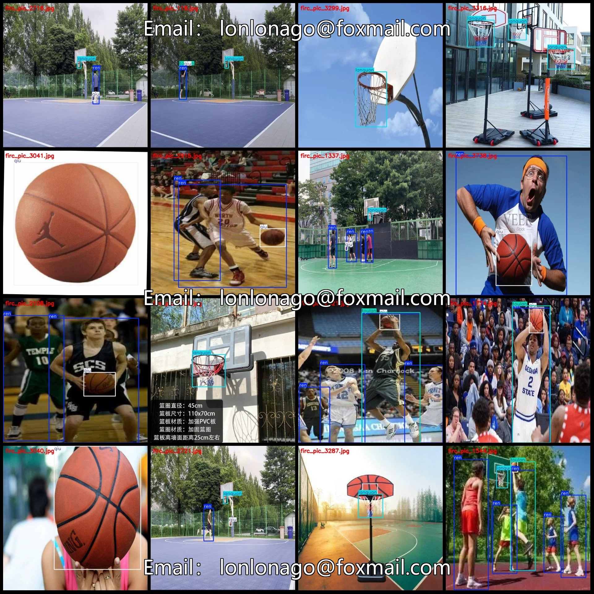
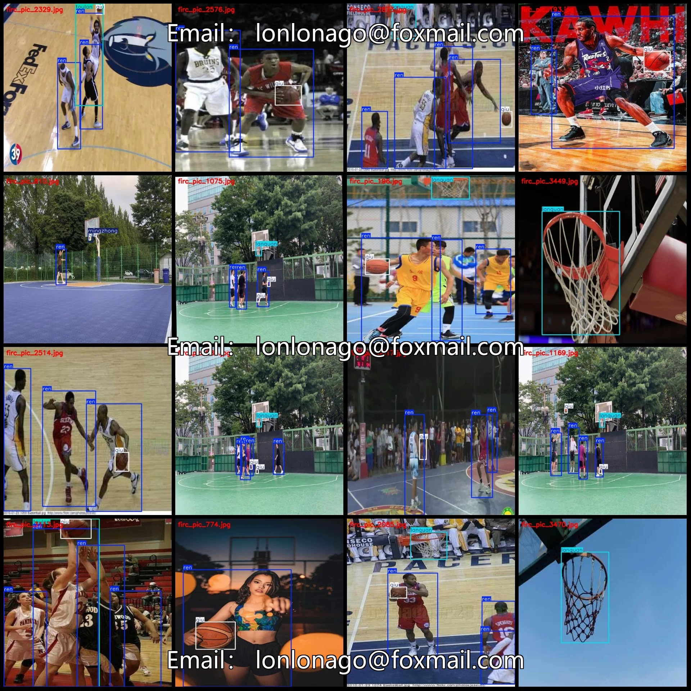
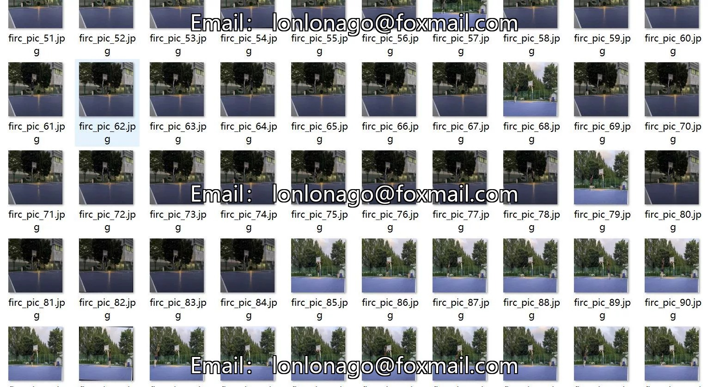
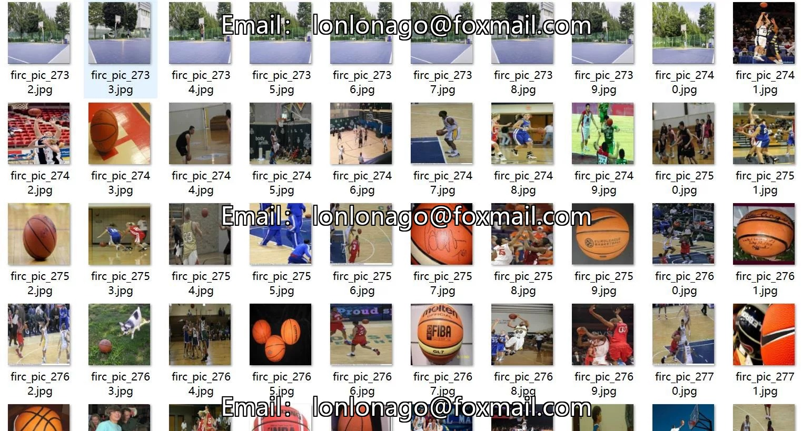
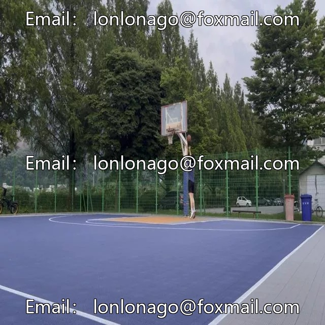
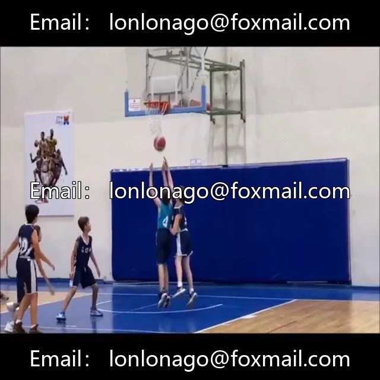
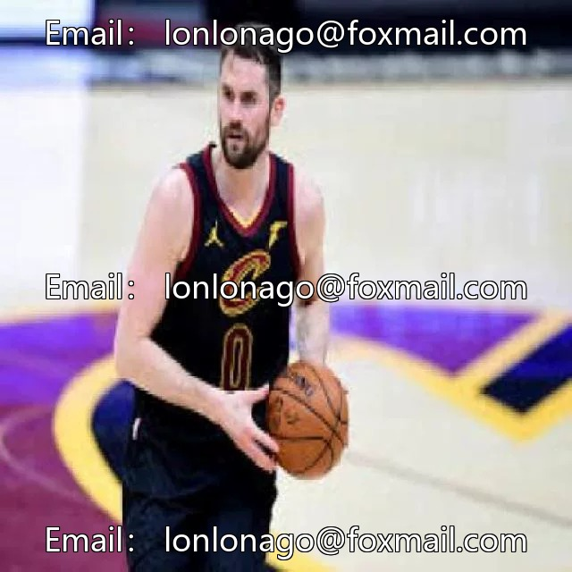

# Basketball sport shooting detection basketball elements detection dataset VOC+YOLO format 383

## Body

Basketball Sports Shooting Detection Basketball Elements Dataset VOC+YOLO Format: 3832 Images in 5 Categories
Warm Reminder: Due to the dataset's replicability, please confirm compliance with requirements before purchasing.
Dataset Format: Pascal VOC format + YOLO format (txt file without split path, only containing jpg images and corresponding VOC format xml files and yolo format txt files)
Number of Images (Total jpg files): 3832
Number of Annotations (Total xml files): 3832
Number of Annotations (Total txt files): 3832
Number of Annotation Categories: 5

1. Category Names: ["lanquan", "mingzhong", "qiu", "ren", "toulan"]
2. Box Counts and Image Counts per Category:
   - lanquan: Boxes = 2552, Images = 2478
   - mingzhong: Boxes = 198, Images = 196
   - qiu: Boxes = 3876, Images = 3263
   - ren: Boxes = 8463, Images = 2702

Toulan Frames = 762, occupied images = 759
Total frames: 15851
Image resolution: 640x640
Labeling tool used: labelImg
Labeling rules: Draw a rectangle around the category.
Important note: The dataset does not have split into training, validation, and test sets; you need to do this yourself.
Special statement: This dataset does not guarantee the accuracy of the trained model or weight files.

## Images

## Payment

Here is a pay link on Stripe ( https://buy.stripe.com/3cs8yP7sY87d0vu9AB ). Please contact me lonlonago@foxmail.com after funding $89, and I will send you a complete data files , thank you!

